  

  <h1>¡Hola! Soy Sergio 👋</h1>
  
<strong>Desarrollador de software en formación · ADSO</strong>

  
Construyo y aprendo con código, bases de datos y herramientas de desarrollo.

---

## 👨‍💻 Sobre mí

- 📍 Neiva, Colombia
- 🐧 Uso Debian GNU/Linux 13
- 🖥️ Mi entorno: fish y tmux
- 🧰 Herramientas: Docker, Git, VS Code y OpenCode

## 🛠️ Tecnologías

  
  
  
  
   
  
  
  
  

---

  Gracias por visitar mi perfil ✨

